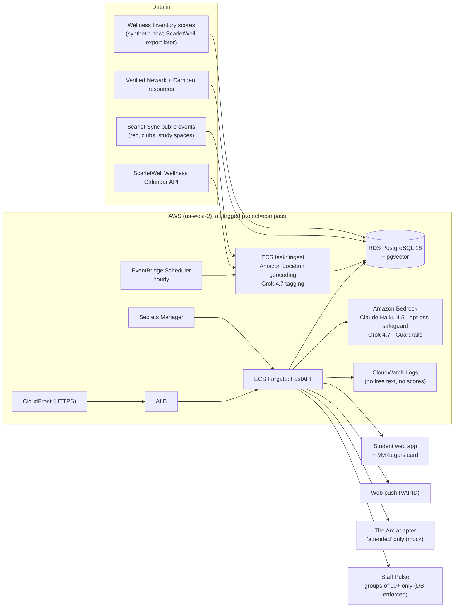

# Compass: how it's built

## Diagram (for the deck)

Inside the API, per request: **safety check** (code lexicon → two model labellers → fixed crisis card) → **care-first rule** (code) →
**fit-first ranking** (code, weights in YAML) → **wording** (cached AI line or template, never waited on) → response with structured reasons.

## How it's built and why it's safe (for non-engineers)

1. Compass reads the Wellness Inventory scores students already have and the events and services Rutgers already lists, and picks one next step that fits each student's week, ranked by fit first and distance second.
2. Every decision that matters (which step, whether to put a person first, any score) is plain code with weights a ScarletWell staffer can read; the AI only labels, tags, and writes a friendly sentence from facts the code already chose, and if the AI is slow or down the app uses templates.
3. Anything a student types is checked for crisis language by code before any AI sees it; a crisis gets a fixed card of verified phone and text lines, the words are never stored, and very low emotional scores route to a person first.
4. Staff only ever see groups of 10 or more students; the database itself refuses to return anything smaller, and only "attended" (never a score) is sent to The Arc.
5. It runs on AWS: one always-warm container behind HTTPS, a managed Postgres database, hourly ingestion of the live Wellness Calendar, and a one-command deploy, so ScarletWell could pilot it in the spring.

## Numbers we can stand behind (measured 2026-10-10, deployed API)

| Metric | Value |
|---|---|
| Student endpoints | `/me/next` p95 0.22 s; `/me/map` p95 0.21 s; `/me/focus` p95 1.36 s (includes two parallel safety labellers); `/wins` p95 0.21 s |
| Staff endpoints | 0.17–0.28 s |
| Crisis test set | 61 crisis + 17 concern + 27 false-alarm phrases; 100% caught by the code lexicon alone (passes with Bedrock blocked); 0 false alarms in the set |
| Stage-2 labellers | Haiku 4.5 p90 0.76 s, gpt-oss-safeguard p90 0.78 s; agreed on 34/35 sampled phrases |
| Real items | New Brunswick 161, Newark 14 researched + Dana Library, Camden 11 researched + Robeson Library, 7 online; plus 56 labelled sample events for Newark/Camden |
| Refresh | Wellness Calendar and Scarlet Sync hourly (incremental on `modified`) |
| Demo reset | ~2 s on AWS |

## What's mocked, and what it takes to make it real

- **The Arc:** no public API found. `ArcAdapter.record_attendance(pseudonym, activity_id, occurred_at)` with a mock; a real adapter is one class once Suitable provides access.
- **Scores and students:** synthetic (1,505 students, 5 personas). Replace `inventory_results.csv` with ScarletWell's de-identified export via the importer; nothing else changes.
- **Sample events:** Newark/Camden sample events are labelled `synthetic` everywhere. Real Newark/Camden resources are researched and sourced.
- **Login:** demo session tokens. A pilot swaps in Rutgers SSO with a hashed subject id.
